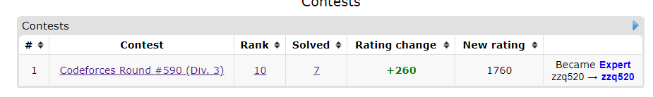

## 参考资料 {#参考资料}

[高维前缀和总结 heyuhhh](https://www.cnblogs.com/heyuhhh/p/11585358.html)

## 子集枚举 {#子集枚举}

$O(4^{n})$ 到 $O(3^{n})$ 的一个优化  
```cpp
for(int s=0;s<(1<<n);s++)
{
    for(int i=s;;i=(i-1)&s)
    {
        //code here...
        if(!i) break;
    }
}
```

首先，对于一个二进制下全是1的数不断减1可以遍历他的所有子集，i-1会把末尾的0都变成1，而\&s则保证了原先s上是0的位仍是0，整个循环相当于一个忽略s中是0的位而不断减1的过程。

[复杂度证明](https://www.acwing.com/community/content/513/)

## 高维前缀和 {#高维前缀和}
### 一维前缀和 {#一维前缀和}
```cpp
for(int i=1;i<=n;i++)
    a[i]+=a[i-1];
```
### 二维前缀和 {#二维前缀和}
```cpp
for(int i=1;i<=n;i++)
    for(int j=1;j<=n;j++)
        a[i][j]+=a[i-1][j];
for(int i=1;i<=n;i++)
    for(int j=1;j<=n;j++)
        a[i][j]+=a[i][j-1];
```

相当于先对列求和，在对行求和

### 三维前缀和 {#三维前缀和}
```cpp
for(int i=1;i<=n;i++)
    for(int j=1;j<=n;j++)
        for(int k=1;k<=n;k++)
            a[i][j][k]+=a[i-1][j][k];
for(int i=1;i<=n;i++)
    for(int j=1;j<=n;j++)
        for(int k=1;k<=n;k++)
            a[i][j][k]+=a[i][j-1][k];
for(int i=1;i<=n;i++)
    for(int j=1;j<=n;j++)
        for(int k=1;k<=n;k++)
            a[i][j][k]+=a[i][j][k-1];
```

可以画个图理解下，，，

### N维前缀和？ {#N维前缀和？}

仿照上面的写法，$n$ 个 $n$ 重循环，每次对一个维度求和即可。

### 状压 \& 与子集枚举的联系 {#状压-amp-与子集枚举的联系}

对于一个 $n$ 维数组，设它所有维度上的最大值为 $k$，我们可以把 $n$ 维上的每一个点压成一个 $k+1$ 进制的数，求高维前缀和时用上面的方法即可。

二进制中的子集关系($i \subset j$)可以看作是每一位上的偏序关系，而 $n$ 维前缀和刚好是满足这种偏序关系的。

所以，对于类似于这类问题：

$$
S_i = \sum_{j\subset i}A_j
$$
$$
F_i = \min_{}\{A_j\},  j\subset i
$$
$$
F_i = \max_{}\{A_j\},  j\subset i
$$

都可以使用高位前缀和的技巧将复杂度由 $O(3^{n})$ 降到 $O(n*2^{n})$

代码也很好写：

```cpp
for(int i=1;i<=n;i++)
    for(int s=0;s<(1<<n);s++)
        if((1<<(i-1))&s)
            f[i]+=f[s^(1<<(i-1))];
```
## 例题 {#例题}
### 1\.[CF1221G Graph And Numbers](https://codeforces.com/contest/1221/problem/G) {#1-CF1221G-Graph-And-Numbers}

题解先坑着，，，

```cpp
LL n,m,c;
vector<int> G[MAXN];
 
LL fpow(LL x,LL k)
{
    LL ans=1;
    while(k)
    {
        if(k&1) ans=ans*x;
        x=x*x,k=k>>1;
    }
    return ans;
}
 
namespace paint
{
    bool flag=1;
    int col[MAXN];
    void dfs(int u)
    {
        for(auto v:G[u])
        {
            if(!col[v]) col[v]=-col[u],dfs(v);
            else if(col[u]+col[v]!=0) flag=0;
        }
    }
    LL solve()
    {
        fp(i,1,n)if(!col[i])c++,col[i]=1,dfs(i);
        //fp(i,1,n)cout << dbgs2(i,col[i]) << endl;
        return flag?fpow(2,c):0;
    }
}
 
LL solve0() //只有0
{
    int cnt=0;
    fp(i,1,n)if(G[i].size()==0)cnt++;//,cout<<dbgs(i)<<endl;
    return fpow(2,cnt);
}
 
LL solve1() //只有1
{
    return paint::solve();
}
 
LL solve2() //只有2
{
    return solve0();
}
 
bool check1(int s)
{
    fp(u,1,n/2)for(auto v:G[u])if(v<=n/2)
    {
        bool a=(1<<(u-1))&s,b=(1<<(v-1))&s;
        if(a&&b) return 0;
    }
    return 1;
}
 
bool check2(int s)
{
    fp(u,n/2+1,n)for(auto v:G[u])if(v>n/2)
    {
        bool a=(1<<(u-n/2-1))&s,b=(1<<(v-n/2-1))&s;
        if(a&&b) return 0;
    }
    return 1;
}
 
LL f[1<<25];
LL solve01() //只有0 1
{
    LL ans=0; mst(f,0);
    fp(s,0,(1<<(n/2))-1) f[s]+=check1(s);//,cout<<dbgs2(bitset<3>(s),f[s])<<endl;
    fp(i,1,n/2)fp(s,0,(1<<(n/2))-1)
        if((1<<(i-1))&s)
            f[s]+=f[s^(1<<(i-1))];
 
    //cout << endl; fp(s,0,(1<<(n/2))-1) cout<<dbgs2(bitset<3>(s),f[s])<<endl;
 
    fp(s,0,(1<<(n-n/2))-1)if(check2(s))
    {
        int t=(1<<(n/2))-1;
        fp(u,n/2+1,n)if((1<<(u-n/2-1))&s)for(auto v:G[u])if(v<=n/2&&t&(1<<(v-1)))
            t-=(1<<(v-1));
        ans+=f[t];
    }
    return ans;
}
 
LL solve02() //只有0 2
{
    return fpow(2,c);
}
 
LL solve12() //只有1 2
{
    return solve01();
}
 
int work()
{
    scanf("%lld%lld",&n,&m);
    if(m==0) return printf("0");
 
    fp(i,1,m)
    {
        int u,v;
        scanf("%d%d",&u,&v);
        G[u].pb(v),G[v].pb(u);
    }
 
    LL ans=0;
    ans+=fpow(2,n);
/*
    cout << dbgs(solve0() ) << endl;
    cout << dbgs(solve1() ) << endl;
    cout << dbgs(solve2() ) << endl;
    cout << dbgs(solve01()) << endl;
    cout << dbgs(solve02()) << endl;
    cout << dbgs(solve12()) << endl;
*/
    ans+=solve0();
    ans+=solve1();
    ans+=solve2();
    ans-=solve01();
    ans-=solve02();
    ans-=solve12();
    return printf("%lld\n",ans);
}
```
### 2\.[CF449D Jzzhu and Numbers](https://codeforces.com/contest/449/problem/D) {#2-CF449D-Jzzhu-and-Numbers}

**题意：**

给定数列 $a_{1}…a_{n}$，计算从中取一段子序列使其 $And$ 起来的和为 $0$ 的方案数。

**SOL:**

考虑容斥计算不合法的方案数，$And$ 后有一位为1的方案数 \- 有两位为1的方案数…

然后考虑如何计算 $n$ 位为1的方案数，设 $f[s]$ 等于满足下面条件的 $a_{i}$ 的个数：

1. $s$ 为1的二进制位上 $a_{i}$ 也为1
2. 其他位上任意

可以发现这是个超集(取反后的子集)，求出 $f$ 数组后就可以愉快的容斥辣

```cpp
int lowbit(int x){return x&-x;}
int bitcount(int x,int cnt=0){while(x)x-=lowbit(x),cnt++;return cnt;}
 
const LL MOD = 1000000007;
LL fpow(LL x,LL k)
{
    LL ans=1;
    while(k)
    {
        if(k&1) ans=ans*x%MOD;
        x=x*x%MOD,k=k>>1;
    }
    return ans;
}
LL C(LL n,LL m)
{
    if(n<m) return 0;
    LL s1=1,s2=1;
    for(LL i=1;i<=m;i++) s1=s1*((n-i+1)%MOD)%MOD;
    for(LL i=1;i<=m;i++) s2=s2*i%MOD;
    return s1*fpow(s2,MOD-2)%MOD;
}
 
int n;
LL s,f[MAXN],ans=0;
 
int work()
{
    scanf("%d%lld",&n,&s);
    fp(i,1,n)scanf("%lld",&f[i]);
    for(int k=0;k<(1<<n);k++)
    {
        LL sum=s+n;
        for(int i=1;i<=n;i++)if((1<<(i-1))&k)sum-=f[i]+1;
        ans+=pow(-1,bitcount(k))*C(sum-1,n-1);
        ans%=MOD,ans+=MOD,ans%=MOD;
    }
    return printf("%lld\n",ans);
}
```
### 3\.[CF1234F Yet Another Substring Reverse](https://codeforces.com/contest/1234/problem/F) {#3-CF1234F-Yet-Another-Substring-Reverse}

**题意：**

给定一个字符串，你可以翻转一段子串(或者不)，之后求原字符串中满足字符两两不同的子串的最长长度。

字符只有 ‘a’\~’t’ (20个)

**SOL：**

首先考虑一下执行翻转操作后答案长啥样，一定是一段没翻转拼上一段翻转过的，所以可以将问题转化为 选两个子串拼起来得到一个新串且满足字符两两不同，求这个新串最长是多少。

考虑状压，$s$二进制位上的1/0代表这个字符出现/没出现。若 $i$ 想和 $s$ 拼到一起的话， $s$ 是1的位置上 $i$ 不能是1，而其他位上没有限制，用高维前缀和处理出满足上述条件的子串的最长长度 $f[i]$ 之后暴力枚举即可。

```cpp
int n;
int f[1<<21],g[1<<21];
char s[MAXN];
 
int lowbit(int x){return x&-x;}
int bitcount(int x)
{
    int cnt=0;
    while(x) x-=lowbit(x),cnt++;
    return cnt;
}
void in(int f[],int pos,int len)
{
    int t=0;
    for(int i=pos;i<pos+len;i++)
    {
        int c=s[i]-'a';
        if((1<<c)&t) return;
        t|=(1<<c);
    }
    f[t]=bitcount(t);
}
 
int work()
{
    scanf("%s",s+1),n=strlen(s+1);
    fd(i,n,1)fp(l,1,min(n-i,20))in(f,i+1,l);
    fp(i,0,19)fp(j,0,(1<<20)-1)
        if((1<<i)&j)
            f[j]=max(f[j],f[j-(1<<i)]);
    reverse(s+1,s+1+n);
    fd(i,n,1)fp(l,1,min(n-i,20))in(g,i+1,l);
    int ans=1;
    fp(s,0,(1<<20)-1)
        if(g[s])
            ans=max(ans,f[((1<<20)-1)^s]+bitcount(s));
    return printf("%d\n",ans);
}
```

~~题外话：有生之年终于AK了DIV3~~


