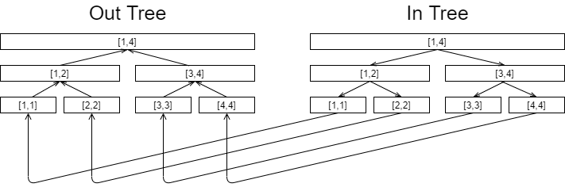
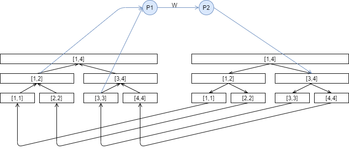

## 线段树合并 {#线段树合并}
### 参考资料 {#参考资料}

[线段树的合并](https://wenku.baidu.com/view/88f4e134e518964bcf847c95.html)

### 简介 {#简介}

默认使用动态开点的线段树

考虑如下问题：现在有两棵值域相同的权值线段树，你需要将两颗线段树对应节点的信息合并，得到一颗新的线段树

显然可以启发式合并做到 $O(lognlogn)$，即把叶子数小的依次插入到另一颗线段树中，在保证总点数是 $n$ 的级别下可以做到两个 $log$

由此引出一个线段树的小技巧：线段树合并

代码大概长这样

```plain
func merge(a,b):
    if a,b中有一个为空:
        返回另一个
    else if a,b都为叶子:
        合并a,b merge_leaf(a,b)并返回结果
    else:
        返回 merge(a-ls,b->ls) 和 merge(a->rs,b->rs) 连接而成的树 
```

分析下复杂度，单次合并操作的复杂度取决于两棵树公共节点(叶子)的个数，可大可小 ($O(1)$ \~ $O(nlogn)$)

假设我们有 $n$ 颗一个元素的线段树，分析下把他合并成一个的复杂度：$O(nlogn)$，因此在保证总点数的情况下复杂度是均摊 $logn$ 的

但实际用起来不一定比两个 $log$ 快。。

```cpp
int merge(int x,int y,int l,int r)
{
    if(x*y==0)return x+y; 
    if(l==r){mx[x]+=mx[y];return x;}
    ls[x]=merge(ls[x],ls[y],l,mid);
    rs[x]=merge(rs[x],rs[y],mid+1,r);
    up(x);return x;
}
```
### 例题 {#例题}
#### 1\. [\[HNOI2012\]永无乡](https://www.luogu.com.cn/problem/P3224) {#1-HNOI2012-永无乡}

并查集\+启发式合并可以做到两个 $log$，线段树合并的话在并查集每次合并的时候（$a->b,fa[b]=a$）合并根节点的线段树：$root[b]=merge(root[b],root[a])$ 即可

```cpp
int n,m,q;
int fa[MAXN],a[MAXN],id[MAXN];
vector<int> X;
namespace seg
{
    int root[MAXN],ls[N],rs[N],s[N],cnt;
    void insert(int &x,int l,int r,int val)
    {
        if(!x)x=++cnt; s[x]++; if(l==r)return;
        if(val<=mid)insert(ls[x],l,mid,val);
        else insert(rs[x],mid+1,r,val);
    }
    int merge(int x,int y,int l,int r)
    {
        if(!(x*y))return x+y;
        if(l==r)return s[x]+=s[y],x;
        ls[x]=merge(ls[x],ls[y],l,mid);
        rs[x]=merge(rs[x],rs[y],mid+1,r);
        s[x]=s[ls[x]]+s[rs[x]];
        return x;
    }
    void query(int x,int l,int r,int k)
    {
        if(k>s[x]){printf("-1\n");return;}
        if(l==r){printf("%d\n",id[l]);return;}
        int num=s[ls[x]];
        if(num>=k)query(ls[x],l,mid,k);
        else query(rs[x],mid+1,r,k-num);
    }
}
int find(int x){return fa[x]==x?x:fa[x]=find(fa[x]);}
void merge(int x,int y)
{
    x=find(x),y=find(y); if(seg::s[seg::root[x]]>seg::s[seg::root[y]])swap(x,y);
    fa[x]=y,seg::root[y]=seg::merge(seg::root[y],seg::root[x],1,n);
}
int work()
{
    scanf("%d%d",&n,&m);
    fp(i,1,n)scanf("%d",&a[i]),X.pb(a[i]);
    sort(all(X));
    fp(i,1,n)a[i]=lb(all(X),a[i])-X.begin()+1,id[a[i]]=i;
    fp(i,1,n)fa[i]=i,seg::insert(seg::root[i],1,n,a[i]);
    fp(i,1,m)
    {
        int u,v;scanf("%d%d",&u,&v);
        if(find(u)!=find(v))merge(u,v);
    }
    scanf("%d",&q);
    while(q--)
    {
        char opt[5]; int x,y;
        scanf("%s%d%d",opt,&x,&y);
        if(opt[0]=='Q')seg::query(seg::root[find(x)],1,n,y);
        if(opt[0]=='B')if(find(x)!=find(y))merge(x,y);
    }
    return 0;
}
```
#### 2\. [CF600E Lomsat gelral](https://www.luogu.com.cn/problem/CF600E) {#2-CF600E-Lomsat-gelral}

自底向上合并线段树即可，线段树上维护每个颜色的最大出现次数和答案

比 $dsu$ 的解法快一点点

```cpp
GE(MAXN,MAXN*2);
int n,cnt;
int a[MAXN],root[MAXN];LL ans[MAXN];
int ls[N],rs[N],mx[N];LL sum[N];
void up(int x)
{
    mx[x]=max(mx[ls[x]],mx[rs[x]]);
    if(mx[ls[x]]==mx[rs[x]])sum[x]=sum[ls[x]]+sum[rs[x]];
    else if(mx[ls[x]]>mx[rs[x]])sum[x]=sum[ls[x]];
    else sum[x]=sum[rs[x]];
}
void build(int &x,int l,int r,int val)
{
    x=++cnt;  if(l==r){mx[x]=1,sum[x]=l;return;}
    if(val<=mid)build(ls[x],l,mid,val);
    else build(rs[x],mid+1,r,val);
    up(x);
}
int merge(int x,int y,int l,int r)
{
    if(x*y==0)return x+y; if(l==r){mx[x]+=mx[y];return x;}
    ls[x]=merge(ls[x],ls[y],l,mid);
    rs[x]=merge(rs[x],rs[y],mid+1,r);
    up(x); return x;
}
void debug(int x,int l,int r)
{
    if(x==0)return; 
    cout << dbgs3(x,l,r) << " " << dbgs2(mx[x],sum[x]) << endl;
    if(l==r)return;
    debug(ls[x],l,mid);
    debug(rs[x],mid+1,r);
}
void dfs(int u,int fa)
{
    build(root[u],1,n,a[u]);
    go(u)if(v!=fa)dfs(v,u),root[u]=merge(root[u],root[v],1,n);
    ans[u]=sum[root[u]];
}
int work()
{
    scanf("%d",&n);
    fp(i,1,n)scanf("%d",&a[i]);
    fp(i,1,n-1)
    {
        int u,v;scanf("%d%d",&u,&v);
        addedge(u,v),addedge(v,u);
    }
    dfs(1,0);
    fp(i,1,n)printf("%lld ",ans[i]);
    return 0;
}
```
#### 3\. [\[Vani有约会\]雨天的尾巴 /【模板】线段树合并](https://www.luogu.com.cn/record/list?user=9467) {#3-Vani有约会-雨天的尾巴-【模板】线段树合并}

如果只有一种颜色，显然做一下树上差分  
```cpp
s[u]++,s[v]++,s[lca]--,s[fa[lca]]--
```
  
然后自底向上合并 s\[ \] 即可。

扩展到多种颜色：为每个节点 $u$ 开一个数组 $f[u][color]$，在颜色对应的位置 \+\+ 或 —

然后每个节点都开一个线段树来维护这个 $f[u]$ 数组，自底向上合并线段树就可以得到每个点的救济粮分发情况

在差分之后也可以沿用 $dsu$ 的解法，复杂度同样是一个 $log$，这里就练一下线段树合并啦

```cpp
int n,m;
int root[MAXN],a[MAXN];
int mx[N],ans[N],ls[N],rs[N],cnt;
void up(int x)
{
    if(mx[ls[x]]>=mx[rs[x]])mx[x]=mx[ls[x]],ans[x]=ans[ls[x]];
    else mx[x]=mx[rs[x]],ans[x]=ans[rs[x]];
}
void insert(int &x,int l,int r,int pos,int add)
{
    if(!x)x=++cnt; if(l==r){mx[x]+=add,ans[x]=l;return;}
    if(pos<=mid)insert(ls[x],l,mid,pos,add);
    else insert(rs[x],mid+1,r,pos,add); up(x);
}
int merge(int x,int y,int l,int r)
{
    if(x*y==0)return x+y; 
    if(l==r){mx[x]+=mx[y];return x;}
    ls[x]=merge(ls[x],ls[y],l,mid);
    rs[x]=merge(rs[x],rs[y],mid+1,r);
    up(x);return x;
}
void dfs(int u,int fa)
{
    go(u)if(v!=fa)
        dfs(v,u),root[u]=merge(root[u],root[v],1,M);
    a[u]=mx[root[u]]?ans[root[u]]:0;
}
int work()
{
    scanf("%d%d",&n,&m);
    fp(i,1,n-1)
    {
        int u,v;scanf("%d%d",&u,&v);
        addedge(u,v),addedge(v,u);
    }
    lca::init(1);
    while(m--)
    {
        int u,v,z;scanf("%d%d%d",&u,&v,&z);
        int l=lca::query(u,v);
        insert(root[u],1,M,z,1);
        insert(root[v],1,M,z,1);
        insert(root[l],1,M,z,-1);
        if(lca::fa[l])insert(root[lca::fa[l]],1,M,z,-1);
    }
    dfs(1,0);
    fp(i,1,n)printf("%d\n",a[i]);
    return 0;
}
```
## 线段树分裂 {#线段树分裂}
## 线段树优化建图 {#线段树优化建图}

依旧由一个问题来引入：[\[PA2011\]Journeys](https://www.luogu.com.cn/problem/P6348)

考虑如何实现区间连边

首先建两棵线段树 $in$ 和 $out$ ，$in$ 中父亲向儿子连边权为 $0$ 的有向边，out 中儿子向父亲连边权为 $0$ 的有向边，两颗树的叶子节点对应着由 $in$ 向 $out$ 连边权为 $0$ 的边

一个 $[1,4]$ 的例子如下：



区间 $[a,b]$ 向 $[c,d]$ 连边的话，首先新建两个节点 $P1$ $P2$，$P1$ 向 $P2$ 连边权为 $1$ 的边，在 $out$ 树上找到 $[a,b]$ 对应的区间并分别向 $P1$ 连边权为 $0$ 的边，$in$ 树同理，$P2$ 分别向 $[c,d]$ 所表示的区间连边

一个 $[1,3]$ 向 $[3,4]$ 连边的例子：



会了这个这个题就很裸了，建完图跑遍最短路即可

```cpp
//点数 n*4*2+m*2*2
//边数 n*4*2+n+(1+logn)*m*2
EDGE(N,M);
int n,m,S,node=0;
int in[MAXN*4],out[MAXN*4],dis[N];
bool v[MAXN];
vector<int> q1,q2;
void build(int l,int r,int cnt)
{
    in[cnt]=++node,out[cnt]=++node;
    if(cnt/2)
    {
        addedge(in[cnt/2],in[cnt],0);
        addedge(out[cnt],out[cnt/2],0);
    }
    if(l==r){addedge(in[cnt],out[cnt],0);return;}
    else build(l,mid,ls),build(mid+1,r,rs);
}
void query(int l,int r,int nl,int nr,int id[],vector<int> &v,int cnt)
{
    if(l==nl&&r==nr){v.pb(id[cnt]);return;}
    if(nr<=mid)query(l,mid,nl,nr,id,v,ls);
    else if(nl>mid)query(mid+1,r,nl,nr,id,v,rs);
    else query(l,mid,nl,mid,id,v,ls),query(mid+1,r,mid+1,nr,id,v,rs);
}
void link(int a,int b,int c,int d)
{
    query(1,n,a,b,out,q1,1),query(1,n,c,d,in,q2,1);
    int t1=++node,t2=++node;
    addedge(t1,t2,1);
    for(auto x:q1)addedge(x,t1,0);
    for(auto x:q2)addedge(t2,x,0);
    q1.clear(),q2.clear();
}
void bfs()
{
    query(1,n,S,S,in,q1,1); S=q1.back();
    deque<int> q; mst(dis,-1); dis[S]=0,q.pb(S);
    while(!q.empty())
    {
        int u=q.front(); q.ppf();
        if(v[u])continue;
        else v[u]=1;
        gow(u)if(dis[v]==-1||dis[u]+w<dis[v])
            dis[v]=dis[u]+w,(w?q.pb(v):q.pf(v));
    }
}
void print(int l,int r,int cnt)
{
    if(l==r){printf("%d\n",dis[in[cnt]]);return;}
    print(l,mid,ls),print(mid+1,r,rs);
}
int work()
{
    scanf("%d%d%d",&n,&m,&S);
    build(1,n,1);
    while(m--)
    {
        int a,b,c,d;scanf("%d%d%d%d",&a,&b,&c,&d);
        link(a,b,c,d),link(c,d,a,b);
    }
    bfs(),print(1,n,1);
    return 0;
}
```
