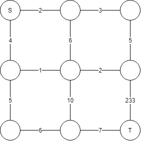
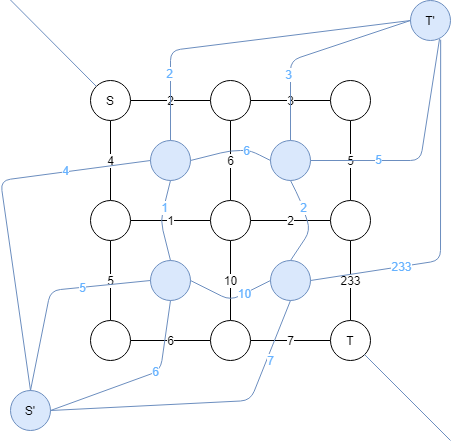

牛客多校出了个题，补下知识点

## 参考资料 {#参考资料}

[网络流（平面图转对偶图） ysner](https://www.cnblogs.com/yanshannan/p/8710804.html)

## 简介 {#简介}

[狼抓兔子](https://www.luogu.com.cn/problem/P4001)

将左上角看作源点，右下为汇，连双向边之后就是一个最小割问题了，但网络流的复杂度无法胜任本题。

注意到最终建出来的图是一个平面图，画一条从左上到右下对角线将最外的无限平面割成两个，求一下对偶图（即平面看作是点，原图中的边看作是连接新图中两个平面的边）

例如下图



转成对偶图就是：



观察原图的任意一个割都可以表示为新图上从 $S’$ 出发到 $T’$ 的一条路径，所以性感理解一下，原图的最大流和最小割就等于新图的最短路。。。

有向图的话，我们可以把所有边按顺(逆)时针转 90° 就得到了新图上的边

```cpp
EDGE(N,N);
int S,T,cnt=0,n,m;
int id[MAXN][MAXN][2];
LL  dis[N];
LL solve()
{
    priority_queue<lpr,vector<lpr>,greater<lpr>> q;
    fp(i,1,cnt)dis[i]=linf; dis[S]=0,q.push({0,S});
    while(!q.empty())
    {
        int u=q.top().se; LL d=q.top().fi; q.pop();
        if(d!=dis[u])continue;
        if(u==T)break;
        gow(u)if(dis[u]+w<dis[v])
            dis[v]=dis[u]+w,q.push({dis[v],v});
    }
    return dis[T];
}
void con(int u,int v,int w)
{
    addedge(u,v,w),addedge(v,u,w);
    // cout << dbgs3(u,v,w) << endl;
}
int work()
{
    scanf("%d%d",&n,&m);
    fp(i,1,n-1)fp(j,1,m-1)id[i][j][0]=++cnt,id[i][j][1]=++cnt;
    S=++cnt,T=++cnt;
    fp(i,1,n)fp(j,1,m-1)
    {
        int w;scanf("%d",&w);
        if(i==1)con(S,id[i][j][0],w);
        else if(i==n) con(id[i-1][j][1],T,w);
        else con(id[i-1][j][1],id[i][j][0],w);
    }
    fp(i,1,n-1)fp(j,1,m)
    {
        int w;scanf("%d",&w);
        if(j==1)con(id[i][j][1],T,w);
        else if(j==m)con(S,id[i][j-1][0],w);
        else con(id[i][j][1],id[i][j-1][0],w);
    }
    fp(i,1,n-1)fp(j,1,m-1)
    {
        int w;scanf("%d",&w);
        con(id[i][j][0],id[i][j][1],w);
    }
    return printf("%lld\n",solve());
}
```
## 练习 {#练习}
### [\[NOI2010\]海拔](https://www.luogu.com.cn/problem/P2046) {#NOI2010-海拔}

先大力来一波结论，每个点的高度就是 0/1，并且高度为 1 的点都与右下的点联通，且 1-\>0 的边构成原图的一个割

然后应用上述技巧，求个最短路即可。

```cpp
EDGE(N,N*4);
int n,m,S,T,cnt;
int c[MAXN][MAXN][2]; //0-left 1-down
int id[MAXN][MAXN];
LL  dis[N];
LL solve()
{
    priority_queue<lpr,vector<lpr>,greater<lpr>> q;
    fp(i,1,cnt)dis[i]=linf; dis[S]=0,q.push({0,S});
    while(!q.empty())
    {
        int u=q.top().se; LL d=q.top().fi; q.pop();
        if(d!=dis[u])continue;
        if(u==T)break;
        gow(u)if(dis[u]+w<dis[v])
            dis[v]=dis[u]+w,q.push({dis[v],v});
    }
    return dis[T]==linf?-1:dis[T];
}
void add(int u,int v,int w)
{
    // cout << dbgs3(u,v,w) << endl;
    addedge(u,v,w);
}
int work()
{
    scanf("%d",&n);
    fp(i,1,n)fp(j,1,n)id[i][j]=++cnt;
    S=++cnt,T=++cnt;
    fp(i,1,n+1)fp(j,1,n)
    {
        int w;scanf("%d",&w);
        int u=(i==1)?T:id[i-1][j];
        int v=(i==n+1)?S:id[i][j];
        add(u,v,w);
    }
    fp(i,1,n)fp(j,1,n+1)
    {
        int w;scanf("%d",&w);
        int u=(j==n+1)?T:id[i][j];
        int v=(j==1)?S:id[i][j-1];
        add(u,v,w);
    }
    fp(i,1,n+1)fp(j,1,n)
    {
        int w;scanf("%d",&w);
        int u=(i==n+1)?S:id[i][j];
        int v=(i==1)?T:id[i-1][j];
        add(u,v,w);
    }
    fp(i,1,n)fp(j,1,n+1)
    {
        int w;scanf("%d",&w);
        int u=(j==1)?S:id[i][j-1];
        int v=(j==n+1)?T:id[i][j];
        add(u,v,w);
    }
    swap(S,T);
    return printf("%lld\n",solve());
}
```
### [牛客多校2020 Day2 Interval](https://ac.nowcoder.com/acm/contest/5667/I) {#牛客多校2020-Day2-Interval}

把所有 $[i,i]$ 都看作一个点，那么问题等价于求 $[1,1]$ 到汇点的一个最小割

```cpp
EDGE(N,N*4);
int n,m,S,T,cnt;
int c[MAXN][MAXN][2]; //0-left 1-down
int id[MAXN][MAXN];
LL  dis[N];
LL solve()
{
    priority_queue<lpr,vector<lpr>,greater<lpr>> q;
    fp(i,1,cnt)dis[i]=linf; dis[S]=0,q.push({0,S});
    while(!q.empty())
    {
        int u=q.top().se; LL d=q.top().fi; q.pop();
        if(d!=dis[u])continue;
        if(u==T)break;
        gow(u)if(dis[u]+w<dis[v])
            dis[v]=dis[u]+w,q.push({dis[v],v});
    }
    return dis[T]==linf?-1:dis[T];
}
void add(int u,int v,int w)
{
    // cout << dbgs3(u,v,w) << endl;
    addedge(u,v,w),addedge(v,u,w);
}
int work()
{
    scanf("%d%d",&n,&m);
    fp(i,1,n)fp(j,1,n)c[i][j][0]=c[i][j][1]=inf;
    fp(i,1,m)
    {
        int l,r,w; char dir;
        scanf("%d %d %c %d",&l,&r,&dir,&w);
        if(dir=='L')c[l][r][1]=min(c[l][r][1],w);
        else c[l][r][0]=min(c[l][r][0],w);
    }
    fp(i,1,n-1)fd(j,n,i+1)id[i][j]=++cnt;
    S=++cnt,T=++cnt;

    // fp(i,1,n-1)fd(j,n,i+1)cout << dbgs3(i,j,id[i][j]) << endl; cout << dbgs2(S,T) << endl;

    fp(i,1,n-1)fd(j,n,i+1)
    {
        //0-left
        if(c[i][j][0]!=inf)
        {
            int u=(i==1)?S:id[i-1][j];
            int v=id[i][j];
            add(u,v,c[i][j][0]);
        }
        if(c[i][j][1]!=inf)
        {
            int u=(j==n)?T:id[i][j+1];
            int v=id[i][j];
            add(u,v,c[i][j][1]);
        }
    }
    return printf("%lld\n",solve());
}
```
